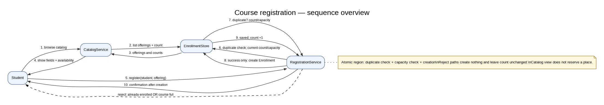
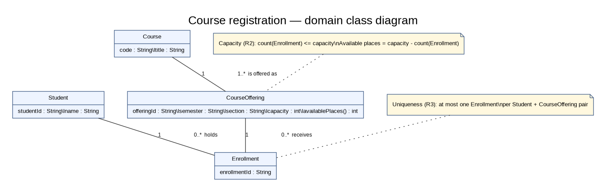
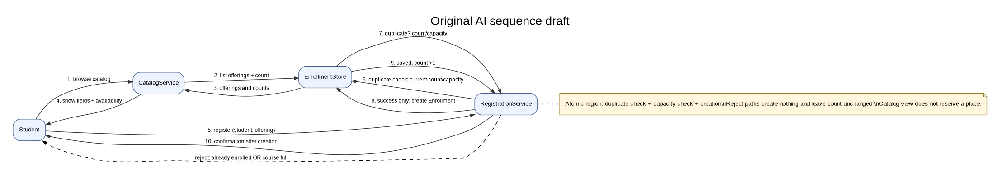
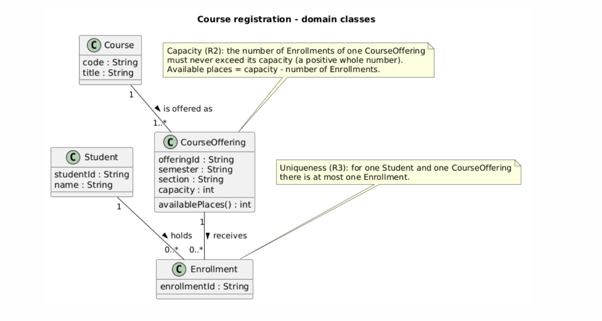

# SIS #02 — AI-Assisted UML Modeling: University Course Registration

<!--
  This is the only file you write your report in. README.md tells you what goes where.

  Rules the checker relies on:
  - Do not delete, rename or renumber the ## headings, the ### headings, or the **Label:** words.
  - Replace every "(write here)" and "(paste here)". None may be left when you submit.
  - Comments like this one are ignored by the checker and the word counter. Delete them or leave them.
-->

## 1. Scope and assumptions

<!-- Your FINAL scope statement and assumptions, after reviewing Prompt A's output. Say here
     what is out of scope (payments, prerequisites, timetable clashes, waiting lists,
     cancellation) — section 2 must not mention them. Section 10 keeps your first version. -->

**Scope:** (write here)

**Assumptions:**

1. (write here)
2. (write here)

## 2. User stories and acceptance criteria

<!-- Your APPROVED requirements: Prompt A's draft after your review. Keep the IDs, the three
     story headings and the bullet shape. Every criterion names the rule(s) it maps to,
     e.g. (R2, R4). Two criteria per story. Nothing out of scope.
     Format of a criterion, on one bullet:
     - **AC-03** (R2, R4): Given ..., When ..., Then ... -->

### US-01 — Browse offerings

**US-01:** (write here — As a student, I want …, so that …)

- **AC-01** (R?): (write here — Given …, When …, Then …)
- **AC-02** (R?): (write here)

### US-02 — Register for an offering

**US-02:** (write here)

- **AC-03** (R?): (write here)
- **AC-04** (R?): (write here)

### US-03 — Receive a clear rejection

**US-03:** (write here)

- **AC-05** (R?): (write here)
- **AC-06** (R?): (write here)

## 3. Sequence diagram

<!-- The FINAL diagram, rendered. Change .png to .svg if that is what you exported. -->



**Participants:** (write here — each lifeline and what it stands for)

**Atomic operation:** (write here — which messages form the one atomic step: the final duplicate check, the capacity check and the creation of the Enrollment, and why a catalog view reserves nothing)

**Where the Enrollment is created:** (write here — which message, which lifeline, and which class in section 4 it produces)

**Technical lifelines:** (write here — every lifeline that is NOT a class in the class diagram, by name, and why the difference in abstraction is fine. "None" if there are none.)

## 4. Class diagram

<!-- The FINAL diagram, rendered. -->



<!-- One row per association in classes.puml, read in both directions. -->

| Association | Read left to right | Read right to left |
| --- | --- | --- |
| (write here) | (write here) | (write here) |
| (write here) | (write here) | (write here) |
| (write here) | (write here) | (write here) |

**How an Enrollment links a student to an offering:** (write here)

**Capacity constraint:** (write here — and why multiplicity alone cannot express it)

**Uniqueness constraint:** (write here — and why multiplicity alone cannot express it)

## 5. Traceability

<!-- Every rule, including the catalog fields and availability (R1). Column 1: the rule and
     the criteria that cover it, e.g. "R2 + AC-03, AC-04". Column 2: the message, guard,
     class or constraint that shows the rule in YOUR diagrams. Column 3: the T-ID that
     exercises it, or the extra check you did instead (R1 has no T case). -->

| Rule and criterion | Model evidence | Validation case |
| --- | --- | --- |
| R1 + (write here) | (write here) | (write here) |
| R2 + (write here) | (write here) | (write here) |
| R3 + (write here) | (write here) | (write here) |
| R4 + (write here) | (write here) | (write here) |
| R5 + (write here) | (write here) | (write here) |

## 6. Walkthroughs

<!-- Walk each case through YOUR final sequence diagram, message by message. Column 2: the
     actual steps and the state change (count before → after). Column 3 starts with Pass or
     Fail, then the location: the message, guard or note where you saw it. A Fail you
     report honestly is a finding, not a penalty. -->

| Case | Observed path and state change | Judgment and evidence |
| --- | --- | --- |
| T1. Available | (write here) | (write here) |
| T2. Last place | (write here) | (write here) |
| T3. Full | (write here) | (write here) |
| T4. Duplicate | (write here) | (write here) |

## 7. Review decisions

<!-- At least three substantive decisions about Prompt C's critique or your own inspection.
     Decision: accepted / rejected / modified — and what you did. Reason: why, in a full
     sentence. Rule: R1–R5. Do not invent an error to fill the table; a justified rejection
     of advice counts. -->

| AI suggestion or model element | Decision | Reason | Rule |
| --- | --- | --- | --- |
| (write here) | (write here) | (write here) | (write here) |
| (write here) | (write here) | (write here) | (write here) |
| (write here) | (write here) | (write here) | (write here) |

## 8. Modeling explanation

<!-- 200–300 words. Your main design choices; how the class diagram and the sequence diagram
     complement each other; why an activity diagram could also help explain the workflow. -->

(write here)

## 9. Reflection

<!-- 150–200 words. Written by you, not by the assistant: where AI helped, one decision you
     made yourself, one remaining limitation. Specific beats flattering. -->

(write here)

## 10. Appendix A — Before AI

<!-- Written BEFORE you run Prompt A, committed and pushed in your first commit, and never
     edited afterwards. This is what you paste into Prompt A as "My initial assumptions". -->

**Scope:** I model how a signed-in student registers for one specific course offering in a university catalog, using a sequence diagram and a class diagram. Payments, prerequisites, timetable clashes, waiting lists and cancellation are outside this work.

**Initial assumptions:**

1. Available places equal the capacity of an offering minus the number of its existing enrollments.
2. If two students request the last place at the same time, only one succeeds and the other gets a "course full" answer.

## 11. Appendix B — AI exchanges

<!-- Complete prompts and complete responses, as text — never screenshots. Paste each inside
     the ~~~~ block that follows its label: AI responses contain ``` PlantUML blocks, and
     ~~~~ keeps them from breaking this file. Prompts B and C: the prompt text first, then
     the material it refers to ("below", "these two") pasted under it, in the same block.
     You may add B5, B6 … after B4 if you ran more. -->

### B1 — Requirements (Prompt A)

- **Tool:** Claude
- **Model:** Sonet 5.5
- **Date:** 18.10.26
- **Purpose:** draft 3 user stories and 6 acceptance criteria

<!-- Model: the exact model with its version, as the tool shows it (e.g. "GPT-5 Thinking",
     "Claude Sonnet 4.5"). If the tool does not show it, write: not displayed
     Date: YYYY-MM-DD -->

**Prompt:**

~~~~text
Act as a requirements analyst. Use only this course registration scenario and rules R1–R5: A student browses an electronic course catalog, chooses a course offering and requests registration. Each offering has a limited number of places. A Course describes a subject. A CourseOffering is one scheduled section in one semester. Registration always targets a specific offering. Assume that the student is signed in, the selected offering exists, and its capacity is a positive whole number. Exclude payments, prerequisites, timetable clashes, waiting lists and cancellation. Use fictional students and courses.
R1. Catalog: Show the course code, title, offering and available places for one semester.
R2. Capacity: Recheck current availability when registering. Enrollment must never exceed the offering's capacity.
R3. Duplicates: A student may have at most one enrollment in the same offering. Reject a repeat request.
R4. Success: Create exactly one Enrollment linking the student and offering, update availability and return a confirmation.
R5. Rejection: Explain "course full" or "already enrolled". Create no enrollment and leave the enrollment count unchanged.
My initial assumptions are <<1. Available places equal the capacity of an offering minus the number of its existing enrollments.
2. If two students request the last place at the same time, only one succeeds and the other gets a "course full" answer.>>.
Draft 3 user stories and 2 Given / When / Then acceptance criteria for each. Use IDs US-01 to US-03 and AC-01 to AC-06. Map each criterion to rule IDs.
Cover normal and rejection behavior. List uncertainty separately. Do not add excluded features or invent university policies.
~~~~

**Response:**

~~~~text
- **Given** LUN205 "Orbital Folklore", Section B, has capacity 2 and 2 enrollments,- **When** the student opens the catalog for its semester,- **Then** the catalog shows LUN205 Section B with 0 available places (2 − 2), not a negative number or a blank. **AC-03 (R2, R3, R4)**- **Given** Mira Okafor has no enrollment in LUN101 Section A, and the offering has 18 available places when the request is processed,- **When** Mira requests registration for that offering,- **Then** exactly one Enrollment linking Mira and LUN101 Section A is created, available places drop to 17, and a confirmation is returned. **AC-04 (R2, R4)**- **Given** LUN310 "Comet Tail Acoustics", Section A, has capacity 1 and 0 enrollments, and Jonas Petrov is not enrolled in it,- **When** Jonas requests registration,- **Then** one Enrollment is created, enrollments equal capacity (1 of 1), available places are 0, and a confirmation is returned. **AC-05 (R2, R4, R5)**- **Given** LUN205 Section B has capacity 2 and 1 enrollment (1 place left), and neither Lena Ito nor Tomas Varga is enrolled in it,- **When** Lena and Tomas both request registration at the same time,- **Then** exactly one of them receives an Enrollment and a confirmation, the other is rejected with "course full" and gets no Enrollment, and the final enrollment count is 2 (never 3). **AC-06 (R3, R5)**- **Given** Mira Okafor already has an enrollment in LUN101 Section A, and the offering still has available places,- **When** Mira requests registration for the same offering again,- **Then** the request is rejected with the explanation "already enrolled", no second Enrollment is created, and both the enrollment count and available places are unchanged. ## Uncertainties (unresolved, nothing further assumed) 1. **Both rejection reasons at once.** If an offering is full and the student is already enrolled, the rules don't say which explanation to show, or whether to show both. A2 covers only the "full" case for a student who is not enrolled.2. **Full offerings in the catalog.** R1 doesn't say whether full offerings stay visible or can be selected. AC-02 assumes only that they are shown with 0 places.3. **Which simultaneous request wins.** A2 says only one succeeds, but not which one, and "at the same time" is not defined (same instant, overlapping processing). AC-05 deliberately accepts either outcome.4. **A2 is not a rule.** R2 requires that capacity is never exceeded, but "the loser gets 'course full'" is an assumption, so it needs confirmation from the stakeholder.5. **Confirmation content.** R4 requires a confirmation but doesn't specify what it contains.6. **Rejection wording.** R5 quotes "course full" and "already enrolled", but it's unclear whether they must appear verbatim.7. **Semester selection.** R1 says "one semester" but doesn't say how the student chooses it or whether there is a default.8. **Catalog freshness.** R2 requires a recheck only at registration, so it's unclear whether the catalog's availability figure must be live or may be slightly stale.9. **Failure handling.** The rules say nothing about errors or interrupted requests, so no criterion covers them. Excluded and not covered: payments, prerequisites, timetable clashes, waiting lists and cancellation. **Trade-off:** AC-05 now covers the simultaneous case, so the plain "full when the request arrives" case has no separate criterion. I can restore that case as a third criterion for US-03 if you want it, though that would break the two-per-story limit.
~~~~

### B2 — UML drafts (Prompt B)

- **Tool:** (write here)
- **Model:** (write here)
- **Date:** (write here)
- **Purpose:** draft the sequence and class diagrams

**Prompt:**

~~~~text
(paste here)
~~~~

**Response:**

~~~~text
(paste here)
~~~~

### B3 — Model critique (Prompt C)

- **Tool:** (write here)
- **Model:** (write here)
- **Date:** (write here)
- **Purpose:** review both models against R1–R5 and T1–T4

**Prompt:**

~~~~text
(paste here)
~~~~

**Response:**

~~~~text
(paste here)
~~~~

### B4 — Focused revision (Prompt D)

- **Tool:** (write here)
- **Model:** (write here)
- **Date:** (write here)
- **Purpose:** apply my accepted review decisions

**Prompt:**

~~~~text
(paste here)
~~~~

**Response:**

~~~~text
(paste here)
~~~~

## 12. Appendix C — Original diagrams

<!-- The AI's first output from Prompt B, rendered unedited from models/original/. -->





## 13. Appendix D — References and source checks

### References

<!-- Full references, one per line, each starting with "- ". Only sources you actually opened.
     Every URL used in the source checks must also appear here. Example:
     - Sommerville, I. (2016). Software Engineering, 10th ed., Global Edition. Pearson. Ch. 5. -->

- (write here)

### Source checks

<!-- At least two modeling decisions you verified. Source and locator: title + slide, page,
     section, chapter or figure — or title + URL + access date (YYYY-MM-DD). Slide numbers
     refer to the decks posted in our Teams. -->

| Modeling decision | Source and locator | What the source says | How it supports or changed your model |
| --- | --- | --- | --- |
| (write here) | (write here) | (write here) | (write here) |
| (write here) | (write here) | (write here) | (write here) |
